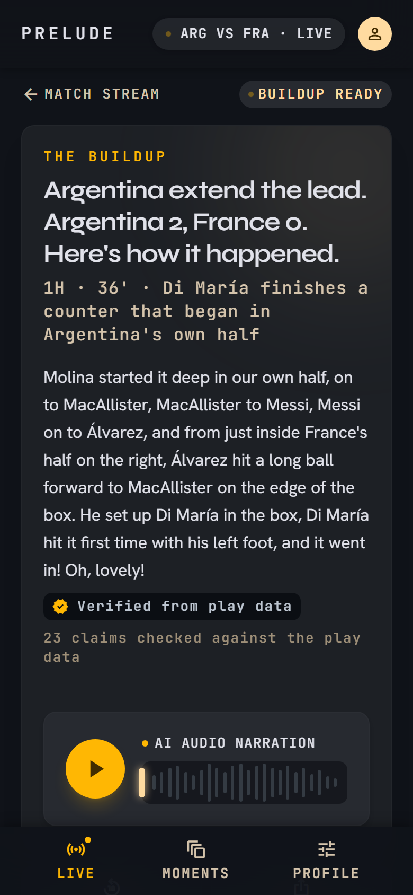
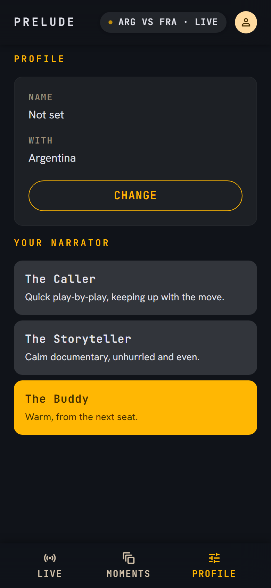
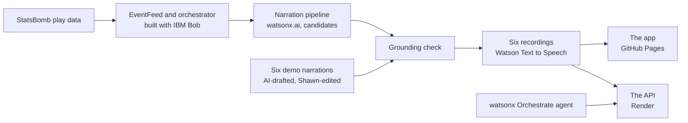
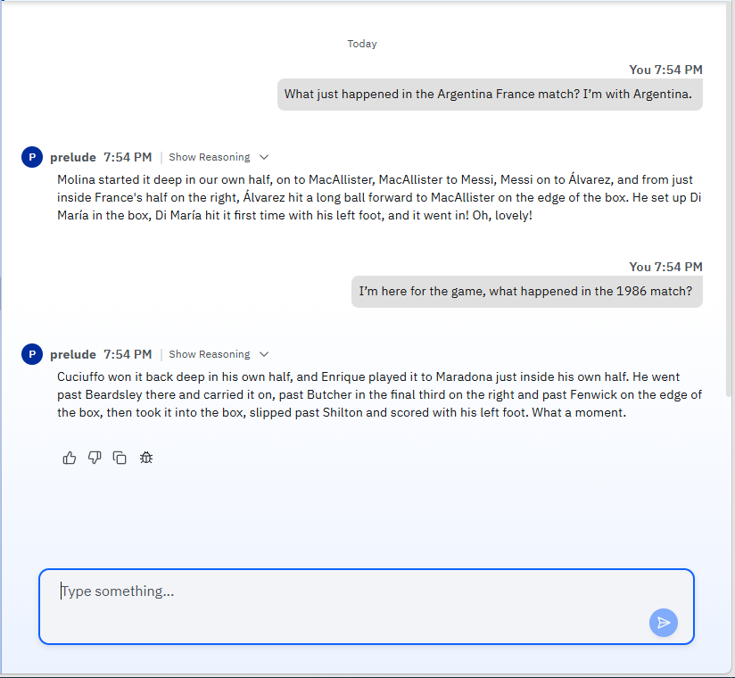
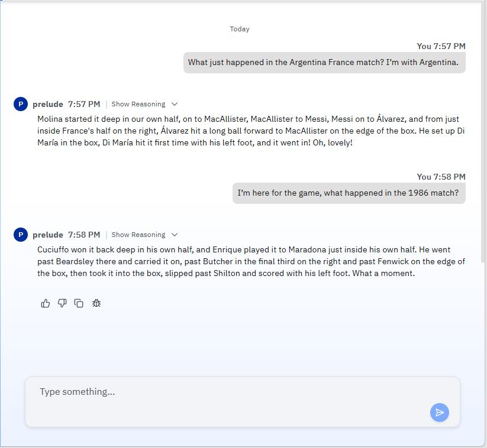

Prelude narrates a football moment in audio, saying only what the play data
can prove.

**Leave your seat. Not the game.**

**[Open the live demo](https://sh4wnbk.github.io/prelude/)**

**[Watch the video](https://drive.google.com/file/d/1ffhGnSRuZfGoVYhSOGU4nKRA5HGi85lk/view?usp=sharing)** · **[See the slides](https://docs.google.com/presentation/d/1jHQDC_digiI2ZV2HbGk1Tfo1PRjEozl6/edit?usp=sharing)**

> [!IMPORTANT]
> The API runs on Render's free tier, which sleeps when idle. After a quiet
> spell, the first answer from the API or the Orchestrate agent can take about
> a minute. Open [/health](https://prelude-api.onrender.com/health) first and
> wait until it shows `"status":"ok"`. The live demo does not depend on the API.

| The launch screen | The moment card | Your narrator |
| :---------------: | :-------------: | :-----------: |
|  |  |  |

## Try it

Point your phone's camera at a code. It opens that ticket in Prelude, with no
app to install and nothing to type.

| Argentina vs England | Argentina vs France |
| :------------------: | :-----------------: |
|  |  |

## Who it's for

The fan is the user: someone at the game who steps away for food or a
restroom and misses a goal. The venue operator is the customer. Prelude is
positioned to ship inside a venue's own app rather than as a separate
download. This repo is the proof of concept for the fan's side; nothing in it
is built for an operator yet.

For the operator, a fan who no longer fears missing the play can step away
when they need to, which spreads the rush on concessions and restrooms. That
effect is for a pilot to measure, and there is no figure for it yet.

## How it works

The same diagram as a picture: [`docs/images/architecture.png`](docs/images/architecture.png).

- The play data is StatsBomb open data for two matches, read from `data/raw/`.
- IBM Bob built the EventFeed and the orchestrator, which find the goals and the run-up to one.
- watsonx.ai writes candidate narrations. The six the demo plays were drafted
  with an AI assistant and edited by Shawn. The grounding check reads every
  claim of both back against the records.
- Watson Text to Speech spoke the six narrations the site plays, once, ahead of time.
- The API on Render exists so a watsonx Orchestrate agent has a stable URL to call.

## Proof

| The 2022 final, asked by an Argentina fan | The 1986 quarter final, asked by a fan of neither side |
| :---------------------------------------: | :----------------------------------------------------: |
|  |  |
| The agent hands over the Buddy's telling for the side that scored. | The agent hands over the Storyteller's neutral telling. |

Both are the live agent in watsonx Orchestrate, answering from the hosted API
on 2026-11-07.

## What is verified

- **The grounding check** reads a narration sentence by sentence against the
  facts each sentence cited. One unsupported claim refuses the whole
  narration. [`docs/THE_LABEL.md`](docs/THE_LABEL.md)
- **The label** "Verified from play data" goes over narration that passed, and
  over nothing else. A browser test asks that of every frame the card passed
  through. [`tests/browser/test_the_label_waits.py`](tests/browser/test_the_label_waits.py)
- **The claim count** under the label is the number the check traced. It is
  read from the record beside the words, never typed.
- **The six narrations** were drafted with an AI assistant, edited by Shawn,
  and verified by the same check.
  [`docs/THE_LABEL.md`](docs/THE_LABEL.md#who-wrote-the-six-and-who-verified-them)

## Built with IBM

| Part | What it does here | Evidence |
| ---- | ----------------- | -------- |
| IBM Bob | built the EventFeed, the orchestrator, the listener card and Profile, the narrator picker and the Orchestrate tool spec, in sixteen of its nineteen sessions | [`bob_sessions/README.md`](bob_sessions/README.md) |
| watsonx.ai | writes a narration from the story beats, and 155 calls compared two models | [`docs/narration_eval.md`](docs/narration_eval.md) |
| Watson Text to Speech | spoke the six recordings the site plays, for 2,403 billed characters | [`docs/IBM_STACK.md`](docs/IBM_STACK.md) |
| watsonx Orchestrate | an agent answers about a match from two read-only tools | [`docs/orchestrate_agent.md`](docs/orchestrate_agent.md) |

## Judging criteria

| Criterion | Where Prelude stands | Evidence |
| --------- | -------------------- | -------- |
| Completeness and feasibility | Seven screens, two matches and six recordings run end to end today | [`docs/CAPABILITIES.md`](docs/CAPABILITIES.md) |
| Creativity and innovation | A narration a fan can trust, because every claim traces to a record | [`docs/THE_LABEL.md`](docs/THE_LABEL.md) |
| Design and usability | One mark and one palette, checked in a browser at 390 by 844 on every push | [`docs/DESIGN.md`](docs/DESIGN.md) |
| Effectiveness and efficiency | Nothing is generated at visit time, so a thousand visits cost what one does | [`docs/HOSTED_API.md`](docs/HOSTED_API.md) |

## What runs where

| Where | What | At visit time |
| ----- | ---- | ------------- |
| GitHub Pages | the app: seven screens and their own fonts, stylesheet and QR reader | serves files, and calls no API |
| Render | the API: three read-only GET endpoints | called by Orchestrate, the smoke check and the keepalive |
| IBM | nothing | the narrations and the recordings were made ahead |

## Limits and what's next

- One goal per match is narrated. Every other moment's play button is disabled
  and says so.
- Nothing is live. The two matches are historical StatsBomb data, replayed.
- The Caller is listed on Profile as coming soon and has no recording, so two
  voices are heard rather than three.
- GPS presence handling is planned, and nothing in this repo reads it yet.
- Audio for a moment other than the two hero goals is planned.

## More

[`docs/CAPABILITIES.md`](docs/CAPABILITIES.md) is the authoritative list of
what runs at this commit. [`docs/DOCUMENTS.md`](docs/DOCUMENTS.md) is every
document in this repo. [`docs/CREDENTIALS.md`](docs/CREDENTIALS.md) is where
the live credentials are and why they are not here.
[`HANDOFF.md`](HANDOFF.md) is the state of the repo and what is next.

Prelude checks itself on every push.
[`.github/workflows/ci.yml`](.github/workflows/ci.yml) runs the unit suite,
five gates and the browser suite.
[`.github/workflows/smoke.yml`](.github/workflows/smoke.yml) checks the
deployed site and the hosted API after each deploy.

---

Play data comes from the
[StatsBomb open data](https://github.com/hudl/open-data) repository, used
under its terms. [`docs/DATA.md`](docs/DATA.md) carries the attribution in
full.

The code is all rights reserved. [`LICENSE`](LICENSE) allows viewing, cloning
and running it to evaluate it or for personal, non-commercial learning, and
nothing else without written permission.

Data provided by StatsBomb.
